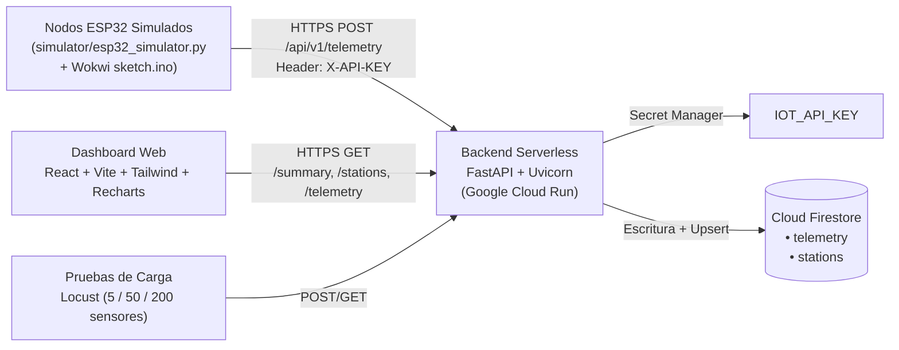

# Sistema IoT Serverless de Monitoreo de Calidad del Agua — Arequipa, Perú

Proyecto final del curso **Servicios Cloud** basado en la **Idea 4: Sistema IoT con backend serverless**. Simula 15 nodos ESP32 enviando telemetría ambiental real de las **5 cuencas hidrográficas de Arequipa** (Camaná, Chili, Ocoña, Tambo y Yauca; dataset Rymes et al., *Data in Brief*, 2024) hacia una API en **Google Cloud Run** conectada a **Cloud Firestore**, con un **dashboard web en React** y **pruebas de carga con Locust**.

---

## Arquitectura



---

## Estructura del Proyecto

```text
iot-agua-arequipa/
├── data/
│   ├── raw/                  # 5 archivos Excel reales (Rymes et al., 2024)
│   └── processed/            # CSV limpios + muestra 15 estaciones + etl_report.json
├── etl/
│   └── clean_arequipa_data.py
├── backend/
│   ├── app/                  # FastAPI, Pydantic v2, alertas, Repository (SQLite / Firestore)
│   ├── tests/                # Suite pytest (25 pruebas unitarias y de integración)
│   ├── Dockerfile            # Imagen ligera python:3.11-slim (puerto dinámico $PORT)
│   ├── .dockerignore
│   ├── .env.example
│   ├── firestore.indexes.json
│   └── requirements.txt
├── simulator/
│   ├── esp32_simulator.py    # Simulador CLI (secuencial y concurrente) + CSV de latencias
│   ├── wokwi_esp32_sketch.ino
│   └── README.md
├── dashboard/
│   ├── src/                  # React + Vite + Tailwind CSS + Recharts
│   ├── .env.example          # VITE_API_URL
│   └── package.json
├── load-tests/
│   ├── locustfile.py         # Pruebas de carga (5, 50 y 200 sensores)
│   ├── requirements.txt
│   └── README.md
└── .gitignore
```

---

## Resumen del Dataset (Fase 1 — ETL)

Ejecución de `etl/clean_arequipa_data.py` sobre los 5 archivos Excel de `data/raw/`:
- **Filas brutas**: `1,412`
- **Descartadas por nulos en parámetros IoT**: `101`
- **Anomalías físicas descartadas** (`pH`, `DO`, `Temp` fuera de rango físico): `5`
- **Filas limpias finales** (`data/processed/arequipa_iot_clean.csv`): `1,306` (`242` estaciones válidas)
- **Muestra de 15 nodos ESP32** (`data/processed/arequipa_sample_15_stations.csv`): `168` lecturas (top 3 estaciones por cuenca)

---

## 1. Ejecución Completa en Local (sin costo cloud)

### Paso 1 — ETL (opcional, los CSV procesados ya están generados)
```powershell
python etl/clean_arequipa_data.py
```

### Paso 2 — Backend FastAPI en modo local (`STORAGE_MODE=local`)
```powershell
cd backend
python -m venv .venv
.\.venv\Scripts\Activate.ps1
pip install -r requirements.txt

# Ejecutar pruebas automatizadas (25 tests)
pytest

# Levantar servidor local con SQLite
$env:STORAGE_MODE = "local"
$env:IOT_API_KEY = "dev-local-key"
$env:ALLOWED_ORIGINS = "http://localhost:5173,http://127.0.0.1:5173"
uvicorn app.main:app --reload --port 8080
```
API docs disponibles en `http://127.0.0.1:8080/docs`.

> Para probar en local contra **Cloud Firestore**, crea `backend/.env` (ignorado por Git) con `STORAGE_MODE=firestore`, `GOOGLE_APPLICATION_CREDENTIALS=./firebase-key.json`, `FIRESTORE_PROJECT_ID=tu-proyecto` y `IOT_API_KEY=tu-clave`.

### Paso 3 — Simulador de nodos ESP32 (en otra terminal, desde la raíz)
```powershell
python simulator/esp32_simulator.py `
  --url http://127.0.0.1:8080/api/v1/telemetry `
  --api-key dev-local-key `
  --mode concurrent `
  --workers 5 `
  --interval 0.05
```
Exporta las latencias en `simulator/latency_results.csv`.

### Paso 4 — Dashboard Web React (en otra terminal)
```powershell
cd dashboard
Copy-Item .env.example .env
npm install
npm run dev
```
Abre `http://127.0.0.1:5173`.

### Paso 5 — Pruebas de carga locales con Locust
```powershell
backend\.venv\Scripts\pip.exe install -r load-tests/requirements.txt
$env:IOT_API_KEY = "dev-local-key"
backend\.venv\Scripts\locust.exe -f load-tests/locustfile.py --headless `
  -u 5 -r 5 -t 1m --host http://127.0.0.1:8080 --csv load-tests/results_5_users
```
Ver detalle de los 3 escenarios (5, 50 y 200 sensores) en [`load-tests/README.md`](load-tests/README.md).

---

## 2. Despliegue en Google Cloud Platform (GCP — Opción A: Cloud Run + Firestore)

> Requiere un proyecto GCP con créditos educativos o facturación activa (Plan Blaze) y **alerta de presupuesto configurada desde el día 1**.

### Variables base (PowerShell)
```powershell
$PROJECT_ID = "utp-iot-arequipa"
$REGION     = "us-central1"
$SERVICE    = "arequipa-iot-api"
$SA_NAME    = "iot-api-runner"
$SA_EMAIL   = "$SA_NAME@$PROJECT_ID.iam.gserviceaccount.com"
```

### 2.1 Configurar proyecto y habilitar APIs
```powershell
gcloud auth login
gcloud config set project $PROJECT_ID

gcloud services enable `
  run.googleapis.com `
  firestore.googleapis.com `
  secretmanager.googleapis.com `
  cloudbuild.googleapis.com `
  artifactregistry.googleapis.com
```

### 2.2 Crear Service Account con mínimo privilegio (`roles/datastore.user`)
```powershell
gcloud iam service-accounts create $SA_NAME `
  --display-name="Arequipa IoT Cloud Run Service Account"

# Acceso mínimo a Firestore (lectura/escritura de datos, sin permisos de admin)
gcloud projects add-iam-policy-binding $PROJECT_ID `
  --member="serviceAccount:$SA_EMAIL" `
  --role="roles/datastore.user"

# Permiso para leer secretos inyectados en Cloud Run
gcloud projects add-iam-policy-binding $PROJECT_ID `
  --member="serviceAccount:$SA_EMAIL" `
  --role="roles/secretmanager.secretAccessor"
```

### 2.3 Guardar `IOT_API_KEY` en Secret Manager (nunca en código ni en Git)
```powershell
# Reemplaza el valor al ejecutar en tu terminal (NO guardar en scripts)
$SECRET_VALUE = Read-Host "Ingresa el valor seguro para IOT_API_KEY"
$SECRET_VALUE | gcloud secrets create IOT_API_KEY --data-file=-
```

### 2.4 Desplegar índices compuestos de Firestore (`backend/firestore.indexes.json`)
Si usas Firebase CLI (recomendado para aplicar directamente el archivo JSON):
```powershell
firebase use $PROJECT_ID
firebase deploy --only firestore:indexes
```
O manualmente vía `gcloud` (ejemplo para el filtro `watershed` + `ingested_at DESC`):
```powershell
gcloud firestore indexes composite create `
  --collection-group=telemetry `
  --field-config=field-path=watershed,order=ascending `
  --field-config=field-path=ingested_at,order=descending
```
(Los 7 índices completos están definidos en [`backend/firestore.indexes.json`](backend/firestore.indexes.json).)

### 2.5 Construir y desplegar en Cloud Run
```powershell
gcloud run deploy $SERVICE `
  --source ./backend `
  --region $REGION `
  --platform managed `
  --allow-unauthenticated `
  --service-account $SA_EMAIL `
  --set-env-vars "STORAGE_MODE=firestore,ALLOWED_ORIGINS=https://TU-DASHBOARD.vercel.app" `
  --set-secrets "IOT_API_KEY=IOT_API_KEY:latest" `
  --min-instances 0 `
  --max-instances 5 `
  --memory 512Mi `
  --cpu 1
```

Verifica el despliegue:
```powershell
$CLOUD_RUN_URL = gcloud run services describe $SERVICE --region $REGION --format="value(status.url)"
curl "$CLOUD_RUN_URL/health"
```
Debe responder `{"status":"ok","storage_mode":"firestore"}`.

### 2.6 Conectar el Dashboard React y el Simulador
- En Vercel / Firebase Hosting, configura `VITE_API_URL=$CLOUD_RUN_URL` y despliega `dashboard/`.
- Actualiza `ALLOWED_ORIGINS` en Cloud Run con la URL final del dashboard:
  ```powershell
  gcloud run services update $SERVICE `
    --region $REGION `
    --update-env-vars "ALLOWED_ORIGINS=https://TU-DASHBOARD.vercel.app"
  ```
- En `simulator/wokwi_esp32_sketch.ino`, reemplaza `API_ENDPOINT` con `$CLOUD_RUN_URL/api/v1/telemetry` y `IOT_API_KEY` con tu clave.

### 2.7 Apagar / limpiar recursos al finalizar la evaluación
```powershell
gcloud run services delete $SERVICE --region $REGION --quiet
```

---

## 3. Alternativa 100% Gratuita sin Tarjeta (Opción B: Firebase Spark + Render + Vercel)

Si tu proyecto Firebase se mantiene en **Plan Spark**:
1. Mantén **Cloud Firestore** en Firebase Spark (20,000 escrituras/día y 50,000 lecturas/día gratis).
2. Despliega `backend/Dockerfile` en **Render Free Tier** (Web Service con Docker) configurando `STORAGE_MODE=firestore`, `IOT_API_KEY`, `ALLOWED_ORIGINS` y el JSON de credenciales como *Secret File* (`/etc/secrets/firebase-key.json`) apuntado por `GOOGLE_APPLICATION_CREDENTIALS`.
3. Despliega `dashboard/` en **Vercel** o **Firebase Hosting** con `VITE_API_URL` apuntando a tu servicio de Render.

---

## Seguridad

- `.gitignore` bloquea `.env`, `.env.*`, `*key.json`, `*credentials*.json`, `local_dev.db`, `.venv/`, `node_modules/` y `__pycache__/`.
- Ningún archivo del repositorio contiene credenciales reales ni API keys hardcodeadas.
- En producción sobre Cloud Run, la autenticación con Firestore usa **Application Default Credentials** de la Service Account (`roles/datastore.user`), sin archivos `.json` dentro del contenedor.
